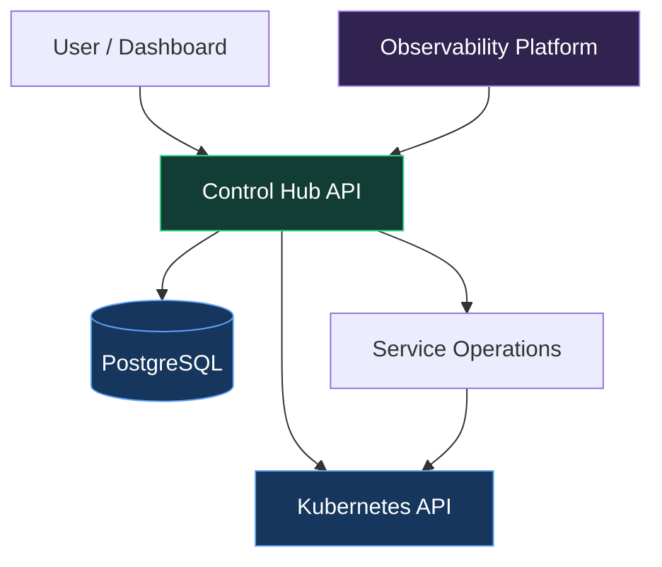

<!--
  GitHub Profile README
  Repository: pestana1213
-->

<div align="center">

<br/>

<a href="https://github.com/pestana1213">
  
</a>

<br/>

[](https://github.com/pestana1213)


</div>

---

## `$ whoami`

I'm a Backend Engineer passionate about designing distributed systems, solving complex engineering challenges, and building reliable software.

I enjoy going beyond application development — understanding architecture, infrastructure, performance and everything that happens in production.

When I'm not building backend services, I'm probably experimenting with my homelab, automating infrastructure or exploring new ways to make software better.

```java
public class Engineer {

    private final String focus = "Backend Engineering";
    private final String[] interests = {
        "Distributed Systems",
        "Cloud & Infrastructure",
        "Performance & Reliability",
        "Observability",
        "AI Engineering"
    };

    public String currentMission() {
        return "Build it. Break it. Understand it. Make it better.";
    }
}
```

## `$ cat current-focus.txt`

| Area | What I'm exploring |
|---|---|
| ⚙️ Backend | Scalable services, API design and clean architecture |
| 🔄 Distributed Systems | Event-driven architectures, Kafka and resilience |
| ☁️ Infrastructure | Kubernetes, GitOps and cloud-native applications |
| 📊 Observability | Metrics, distributed tracing and structured logging |
| 🤖 AI Engineering | LLMs, RAG and AI-powered developer tools |

## `$ ls ./projects`

### ⭐ Control Hub

**A control plane for my Kubernetes homelab.**

Building a centralized platform to discover, monitor and manage applications running in my K3s cluster.

The goal is to move beyond simply deploying applications and create a proper control plane with application discovery, observability and safer operational actions.

**Current direction:**
- Kubernetes application discovery.
- Application health and observability.
- Centralized service management.
- Operational insights and automation.

[](https://github.com/pestana1213/control-hub)

### 🏠 Golias Homelab

My self-hosted infrastructure and playground for learning cloud-native technologies.

K3s, GitOps, networking, storage, monitoring and automation.

[](https://github.com/pestana1213/golias-homelab)

### 🧠 Atena AI

Exploring AI-powered code review and developer productivity through LLM-based tooling.

---

## `$ cat architecture.md`

One of the things I enjoy most is understanding how systems communicate and how to make them reliable.

A conceptual view of the Control Hub direction:



*Conceptual architecture — evolving alongside the project.*

---

## `$ tech-stack --all`

<div align="center">

**Languages & Backend**


**Messaging, Cloud & Infrastructure**


**Observability & Tools**


</div>

---

## `$ git stats`

<div align="center">


<br/>


</div>

---

## `$ connect`

I'm always happy to discuss backend engineering, distributed systems, architecture, infrastructure and interesting technical challenges.

<div align="center">

[](https://github.com/pestana1213)

<br/>

**Build it. Break it. Understand it. Make it better.**

<sub>Happy coding! 🚀</sub>

</div>
